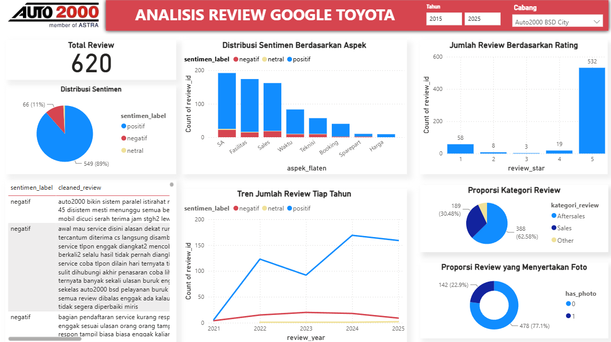
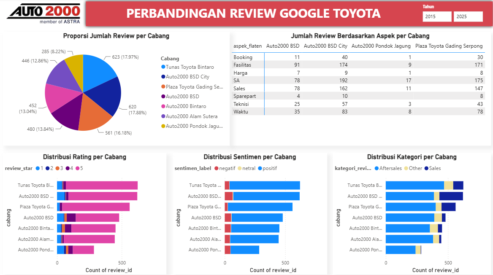

# Customer Review Analytics | Auto2000 BSD City

**Customer experience analytics · Natural Language Processing · Business Intelligence**

**Stack:** Python, pandas, scikit-learn, TF-IDF, XGBoost, rule-based text classification, Apify, Google Sheets, GitHub Actions, Power BI

> **Project context:** Business Data Analyst internship, Auto2000 BSD City, July–August 2025. This case study distinguishes outcomes documented during the internship from retrospective exploratory findings and proposed improvements.

## Executive summary

Developed and tested an integrated Google Reviews analytics workflow to help aftersales stakeholders examine customer feedback beyond average star ratings. The workflow collected reviews, cleaned and classified text by sentiment and service category, identified up to three service-related aspects, and presented results in an interactive Power BI dashboard. The dashboard supported filtering by branch, year, and sentiment, with review text available for investigation.

Across **seven Toyota branches**, the original collection contained **6,634 raw review records**. The internship report documents **3,467 records retained after preprocessing**, including **620 Auto2000 BSD City reviews**. These are different stages of the data pipeline; 6,634 is *not* the number of final classified text reviews.

The workflow was presented to the Service Head and Customer Relations Coordinator (CRC) and tested end-to-end during the internship. **No reduction in complaints, increase in satisfaction, or time savings was quantified.**

## 1. Business problem

Customer feedback on Google Maps contains useful details about appointments, waiting time, communication, technical service, staff, and facilities. However, overall star ratings alone do not explain which parts of the customer experience need investigation. Reading individual reviews also makes it difficult to compare patterns systematically across periods and branches.

During field observations at Auto2000 BSD City, customers described discrepancies between promised and actual completion times, unclear waiting-time information, and challenges in service coordination. These observations provided operational context for an analytics workflow requested by the Service Head and used for review by the Service Head and CRC.

**Business question:** How can customer reviews be organized so that aftersales stakeholders can identify recurring service concerns, investigate the original comments, and prioritize follow-up?

## 2. Stakeholders and objectives

**Primary stakeholders:** Service Head and Customer Relations Coordinator (CRC).

Objectives:

1. Convert unstructured review text into structured sentiment, service-category, and aspect information.
2. Make review patterns accessible through interactive Power BI filters, while retaining the ability to read underlying comments.
3. Support exploratory comparisons across branches and time periods.
4. Test a repeatable data-processing workflow from review collection to dashboard visualization.

## 3. Data scope and preparation

The original internship workflow used Apify's Google Maps Review Scraper with reviews sorted by **newest**, targeting **up to 1,000 records per branch**. Some branches returned fewer than 1,000. Records with no review text were removed, followed by text normalization, language-related filtering, and other preprocessing.

| Dataset stage | Records | Interpretation |
| --- | ---: | --- |
| Seven branches — collected | 6,634 | Raw scraped records before text-focused preprocessing |
| Seven branches — retained | 3,467 | Reported final records after preprocessing |
| BSD City — collected | 1,000 | Raw records |
| BSD City — retained | 620 | Reported records after preprocessing |

Review timestamps span historical periods; the collection itself was performed during the internship, not continuously across all review years.

**Data provenance note:** A later working Excel file contains additional BSD City reviews, including records dated after the internship. It is **not** used to represent the original 2025 internship results. The three historical sentiment exports reproduce the dashboard totals of **549 positive, 66 negative, and 5 neutral reviews** (620 in total). The positive CSV contains **531 exported rows** because the Power BI visual groups some identical review texts and aggregates numeric fields; it must not be treated as 531 distinct source reviews. The original per-review data is preferable for a fully reproducible record-level analysis.

## 4. Analytical approach

### Review collection and processing

**Apify → Google Sheets → Python processing → classified outputs → Power BI**

The documented internship implementation also tested a GitHub Actions workflow to run processing scripts and update Google Sheets. The system was **tested during the internship**; this repository does not claim independently verified continuous production operation or automatic Power BI refresh after the internship.

### Sentiment classification

- **Target classes:** Positive, neutral, and negative.
- **Method:** Text preprocessing → TF-IDF (unigrams and bigrams) → XGBoost, with threshold-related decision logic described in the project documentation.
- **Model development:** The report describes **966 manually labeled training/evaluation records**, annotated with involvement from two interns and the CRC, class balancing, and hyperparameter selection using GridSearchCV.
- **Important:** The output is an **automated sentiment estimate**, not a definitive human judgment about the customer experience.

### Service-category and multi-aspect classification

- **Service category (rule-based):** Sales, Aftersales, Other.
- **Aspects (rule-based):** Booking, Waiting/Service Time, Service Advisor (SA), Technician, Spare Parts, Price, Facilities, and Sales; an Other label is also possible.
- The implementation stores up to **three aspect columns** per review. When fewer than three distinct aspects are identified, the algorithm can repeat a label. Therefore, **aspect columns cannot simply be summed as independent complaints**.
- The aspect labels identify *topics mentioned*, not whether each topic is praised or criticized. An overall negative review mentioning “facilities” does not automatically mean the facilities were criticized.

### Reported model evaluation

| Component | Reported accuracy | Reported F1-score | Evaluation basis |
| --- | ---: | ---: | --- |
| Sentiment (TF-IDF + XGBoost) | 94% | 0.87 | Held-out test set, as stated in the internship report |
| Service category (rules) | 97% | 0.97 | Manually labeled validation sample, as stated in the report |
| Multi-aspect (rules) | 95% | 0.95 | Manually labeled validation sample / aspect positions, as stated in the report |

*These values are reproduced from the internship report, not independently re-estimated from the exported dashboard CSVs. Category and aspect scores should be interpreted in light of the reported sampling and label-position evaluation procedures.*

## 5. Interactive Power BI dashboard

The dashboard was designed to support:

- **Branch and year filters** for viewing a selected location and period.
- **Sentiment filtering** to inspect reviews classified as positive, neutral, or negative.
- **Underlying review text** for qualitative investigation.
- **Category and aspect distributions** to understand the topics discussed.
- **Star-rating distributions** to compare ratings with predicted text sentiment.
- **Photo-presence indicators** to identify reviews that include an image attachment.
- **Cross-branch comparison** of review metrics and service topics.

**Interpretation safeguards:** A photo-presence flag does *not* verify the accuracy of a complaint, since the photo itself was not evaluated. Review counts also reflect selected records that contain text, not all customers or a representative satisfaction survey.

### Dashboard preview — Branch analysis



*Branch-level overview of Google Reviews, including sentiment, ratings, service aspects, category composition, photo presence, and review text. Filters change the displayed results; screenshot figures should be read in the context of the selected branch and years.*

### Dashboard preview — Branch comparison



*Cross-branch comparison of review volumes, ratings, predicted sentiment, service categories, and aspect mentions. Different review volumes and preprocessing retention rates limit direct performance comparisons.*

**Screenshot privacy note:** Dashboard images should be checked for customer names, identifiable review text, and non-public company information before publication.

## 6. Retrospective findings: BSD City case study

The following findings come from a **post-internship exploratory review** of historical exports and field notes. They are not claimed as decisions implemented by the company in 2025.

### Finding 1 — Appointment handling and waiting-time expectations

Of **66 reviews automatically labeled negative** in the historical dashboard export, the automated aspect fields identify **34 reviews mentioning Time** and **31 mentioning Booking** (counted by unique review, not by repeated aspect column). Some review texts describe scheduled appointments followed by additional waiting or service completion later than expected.

**Business implication:** Appointment confirmation does not, by itself, describe the entire customer experience. Time between arrival, service reception, and actual completion may each need separate monitoring.

**Important qualification:** These are topic mentions within reviews labeled negative overall. The counts are **not independently verified counts of complaints about each aspect**, and topics overlap.

### Finding 2 — Responsiveness and progress communication

Review texts include complaints about unanswered or delayed calls/messages and insufficient information about service progress. Field observations separately recorded waiting-time uncertainty and communication difficulties.

**Business implication:** Communication responsiveness and updates during delays are plausible candidates for operational review. The available review data does not establish the underlying staffing or system causes.

### Finding 3 — Service completion and quality concerns

Some reviews report that a vehicle problem persisted after service or that expected work outcomes were unclear.

**Business implication:** These cases warrant targeted inspection of work orders, diagnostic records, service completion checks, and repeat visits. The review alone cannot confirm technical fault or determine responsibility.

### Finding 4 — Negative feedback can be missed by sentiment-only filtering

A targeted review of the exported **positive** and **neutral** groups found examples containing criticism, including some low-star reviews automatically labeled positive. Other comments combine praise with a specific complaint. Conversely, a few automatically negative reviews contain largely positive text.

**Business implication:** A negative-only filter is useful for triage but **cannot be assumed to capture every important customer issue**. Suggested follow-up includes cross-checking low-star reviews, mixed-sentiment comments, and potentially serious service complaints.

**Not a revised model score:** This targeted inspection was not a new, independently labeled representative test set and should not be used to calculate a new accuracy or false-negative rate.

## 7. Recommended operational follow-up

These are **analyst recommendations based on retrospective review**, not confirmed actions taken by Auto2000.

| Investigation priority | Proposed action | Suggested KPI / validation data |
| --- | --- | --- |
| Appointment and reception | Compare scheduled appointment time with actual arrival and first Service Advisor contact | Appointment-to-reception waiting time; % appointments received within target |
| Service timing and updates | Compare promised completion times with actual completion, and review how delays are communicated | Completion-time deviation; % customers proactively informed of delays |
| Communication accessibility | Audit how booking calls, WhatsApp inquiries, and escalation requests are handled | First response time; unanswered inquiry rate |
| Technical service outcomes | Review repeat complaints against relevant service/work-order records | Same-issue repeat visits; confirmed unresolved cases |
| Feedback-review reliability | Flag low-star reviews and likely mixed-sentiment or high-severity cases for manual inspection | Negative-class recall on a labeled audit sample; high-priority cases reviewed |

Priorities are **proposed investigation areas**, not a quantified ranking of financial losses or proven root causes. Actual causes should be established using operational records, interviews, and follow-up investigation.

## 8. Delivered outcome and business value

**Delivered during the internship:**

- A workflow linking Google Reviews collection, Python-based classification, Google Sheets, and Power BI.
- Interactive dashboard views for service-feedback investigation and cross-branch exploration.
- Reported model and rule-based classification evaluations.
- End-to-end testing, stakeholder presentation, and documented project revisions.

**Potential business value:** Reduce the friction of exploring large volumes of feedback; make recurring service topics easier to locate; support CRC and Service Head reviews with accessible customer comments and contextual metrics.

**Not established:** Ongoing production adoption, a measured reduction in customer complaints, a measured decrease in operational handling time, or proven improvements in satisfaction/retention.

## 9. Limitations and lessons learned

1. **Imperfect classification.** Negative/neutral reviews can be confused with positive feedback. Human review is appropriate before acting on sensitive or high-impact cases.
2. **Overall vs. aspect sentiment.** The model predicts an overall label; aspect tags are topic indicators and do not specify positive/negative sentiment for each aspect.
3. **Repeated labels.** Up to three aspect columns may repeat a category; analysis should deduplicate aspects within each review.
4. **Sampling limitations.** At most 1,000 most-recent raw records were collected per branch during the internship, and preprocessing further reduced the review population. Comparisons should not be interpreted as representative of all customers or all historical experiences.
5. **Data/version differences.** The original report contains a BSD City count of 620 after preprocessing, whereas a separate category table totals 628. The historical dashboard sentiment totals support the 620 figure, but this discrepancy should remain documented until the underlying original source is reconciled.
6. **Export aggregation.** Power BI can group duplicate review texts, causing summed rating/year fields in exported visuals; the aggregated CSV is not a substitute for a row-level source dataset.
7. **No impact experiment.** The project did not quantify downstream operational improvements or establish causality between review themes and specific process failures.

## 10. Reproducibility and responsible data handling

This public repository is organized as follows:

```text
customer-review-analytics/
├── README.md
├── customer_review_analytics.ipynb
├── requirements.txt
└── images/
    ├── dashboard_branch_analysis.png
    └── dashboard_branch_comparison.png
```

**Notebook:** [`customer_review_analytics.ipynb`](customer_review_analytics.ipynb) documents the cleaned, portfolio-facing processing and inference workflow. It loads a previously trained TF-IDF vectorizer and XGBoost model; it does **not** reproduce the original model-training experiment or evaluation figures from scratch. Running it requires authorized Google Sheets access and the original `.pkl` artifacts, which are not included in this repository.

**Dependencies:** [`requirements.txt`](requirements.txt) lists the Python package requirements; it should be checked against the notebook imports before publication.

Before publishing, remove API credentials, spreadsheet IDs with restricted access, customer-identifying details, and private business information. If the complete source review data cannot be shared, publish sanitized examples, data definitions, screenshots with identifying details obscured, and clear reproduction instructions instead. Avoid committing trained model files unless redistribution is permitted and the provenance is documented.

## Source and evidence notes

- **2025 internship report:** *Laporan Praktik Kerja Lapangan di Toyota Auto2000 BSD City*, particularly the data tables, sentiment evaluation, classification results, integration workflow, and dashboard sections.
- **2025 PKL field notes:** Operational observations involving service waiting times, customer communication, and workflow handoffs.
- **Public project notebook:** [`customer_review_analytics.ipynb`](customer_review_analytics.ipynb), a streamlined portfolio version of the processing/inference code. The internship report separately documents model development and evaluation.
- **Historical dashboard exports:** `Auto2000_BSD_City_Review_{Negatif,Positif,Netral}_2025.csv`; exported chart data may be aggregated by displayed review text.
- **Dashboard screenshots:** [`images/dashboard_branch_analysis.png`](images/dashboard_branch_analysis.png) and [`images/dashboard_branch_comparison.png`](images/dashboard_branch_comparison.png).

**Project role and attribution:** Developed as part of the documented internship project with a fellow student and guidance from Auto2000 stakeholders. Any individual GitHub profile should describe the author's own contributions accurately and acknowledge collaboration where relevant.
